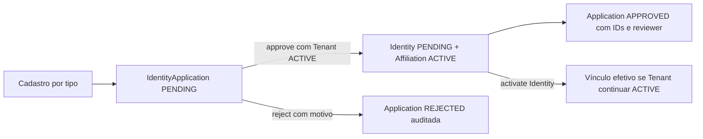

# Fluxos e concorrência de Identity

## Solicitação e resolução

Create valida a reserva pendente e o cadastro operacional. Approve resolve o ator, toma lock na application,
revalida conflitos e bloqueia o Tenant antes de provisionar o tipo correto e o vínculo escolhido. Registra reviewer,
reviewedAt, resolvedIdentityId, assignedTenantId e resultingAffiliationId em uma transação.
Falha no código específico, no Tenant, na gravação de Identity/Affiliation ou na resolução reverte todo o conjunto.
Reject registra somente a decisão; não provisiona dados operacionais. Resolução é permitida uma única vez.

## Exclusão própria

1. CurrentActor identifica o alvo, que nunca vem de um ID enviado pelo cliente.
2. O caso de uso bloqueia a Identity e valida motivo/tempo.
3. Registra a solicitação durável de revogação.
4. Bloqueia todos os vínculos da Identity por UUID, em ordem estável, incluindo INACTIVE e todos os Tenants.
5. Persiste/flush IdentityHistoryEntity e um AffiliationHistoryEntity para cada vínculo, antes de qualquer remoção.
6. Remove todas as Affiliation operacionais e suas especializações, depois a hierarquia JOINED de Identity.
7. Confirma tudo junto. Qualquer falha reverte os dois históricos, exclusões e outbox.

O histórico armazena UUID original, kind, estado anterior, timestamps, deletedAt, ator, motivo e JSON dos campos
persistidos. Não possui FK para o registro removido nem unicidade de CPF/CNPJ/e-mail. Referências de auditoria de aplicações
resolvidas permanecem informativas, mesmo após a exclusão operacional.

## Controles concorrentes

| Recurso | Proteção |
| --- | --- |
| Lifecycle Identity/Tenant e resolução de application | Pessimistic write no agregado |
| Cadastro/revisão com chaves naturais sobrepostas | Advisory locks transacionais PostgreSQL, ordenados pelo hash das chaves canônicas |
| Aprovações no mesmo Tenant | Lock do Tenant antes dos identificadores específicos |
| Código do vínculo por Tenant | Índices únicos e FK composta entre base e especialização |
| Nickname por tipo e aplicações PENDING | Índices únicos case-insensitive, incluindo predicados de estado; e-mail sem unicidade |
| Atualização de registros JPA | Versionamento otimista existente |

Os locks de registro usam hashes; os valores pessoais não são gravados como chave de lock. Constraints continuam sendo
a última barreira para escrita concorrente. Conflitos previsíveis não se tornam sucesso parcial. Os testes exercitam
dois submits simultâneos e duas aprovações simultâneas, além de falhas reais de histórico/delete/revogação.
